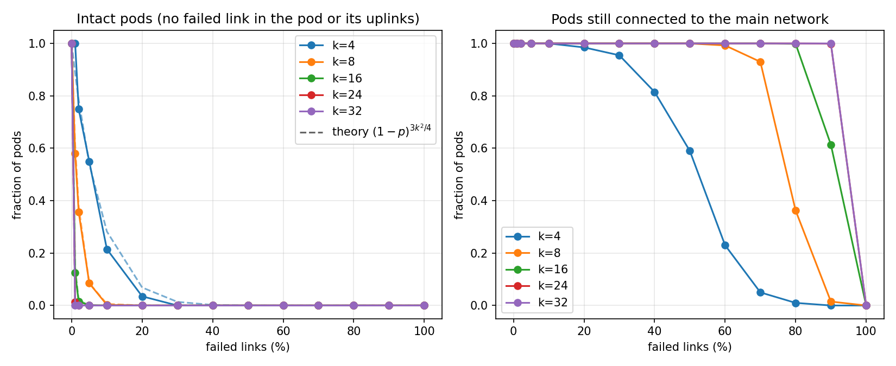

## Background

A fat-tree is built for data centers (and supercomputers), where the “leaves” are servers doing compute work.
If one server loses its link, the job scheduler just moves the work to another healthy CPU/GPU server.

The Root is at the top: the core switches.


Bandwidth - how much data can flow through a link \ network.

## Approach

Based on Al-Fares, Loukissas, Vahdat, *A Scalable, Commodity Data Center Network Architecture* (SIGCOMM 2008).

- **Topology:** `build_fat_tree(k)` builds the nodes (core, aggr, edge, host) and links top-down: core-aggr, aggr-edge, edge-host. In a pod, every edge switch connects to every aggr switch; aggr switch `a` connects to core row `a`, so each core switch reaches every pod once. Each link records the port on both ends.
- **Validation:** `check_counts` compares the generated network with the paper's formulas (see the table below).
- **Failures:** `fail_links` removes the requested percentage of links at random and returns the links that are alive and the ones that failed.
- **Analysis:** for each k and failure percentage, random failures are repeated and a depth-first search over the surviving links finds the groups of hosts that can still reach each other. Each pod is classified as intact or connected, and the results are averaged and plotted.

## Instructions for running the code

Two files:

| File | Purpose |
|---|---|
| `fat_tree.py` | Builds the topology (nodes and links), fails links, prints a summary |
| `analysis.py` | Runs the pod-survival experiment and saves `fat_tree_analysis.png` |

### Input parameters

- `k` (int, even, >= 2): number of ports per switch. Every switch is identical, and this single parameter fixes the whole topology:

| Quantity | Value |
|---|---|
| pods | k |
| aggr / edge switches per pod | k/2 each |
| core switches | (k/2)^2 |
| hosts per edge switch | k/2 |
| total switches | (k/2)^2 + k^2 = 5k^2 / 4 |
| total hosts | k^3 / 4 |
| total links | 3 · k^3/4 = 3k^3 / 4 (core-aggr, aggr-edge, edge-host) |

  Examples: k=4 gives 16 hosts and 20 switches (Figure 3 of the paper).

- `fail_percent` (float in [0, 100], optional, default 0): percentage of links (of all links, any layer) that fail.
- `seed` (int, optional): random seed, so the same failures can be reproduced.

### Usage

```
python fat_tree.py 4                              # print summary
python fat_tree.py 4 --verbose                    # also print every link
python fat_tree.py 8 --fail-percent 10 --seed 1   # fail 10% of the links
python analysis.py                                # run the experiment, save fat_tree_analysis.png
```

From Python:

```python
from fat_tree import build_fat_tree, fail_links
nodes, links = build_fat_tree(4)
alive, failed = fail_links(links, 10, seed=1)
```


## Experiment: pod survival under link failures

**Question:** a pod is the basic building block of the fat-tree (k/2 edge + k/2 aggr switches and k^2/4 hosts). When a percentage of links fails, how many pods are still intact, and how many are still connected to the rest of the network? How does this change as k grows?

**Setup:** for every k in `K_VALUES` = [4, 8, 16, 24, 32] and every failure percentage in `FAIL_PERCENTS` = [0, 1, 2, 5, 10, 20, ..., 100]:

1. build the fat-tree and fail that percentage of links at random (`fail_links`),
2. find the groups of hosts that can still reach each other,
3. classify every pod,
4. repeat `TRIALS` = 50 times with different random failures and average.

**Metrics** (both are a fraction of the k pods):

1. **Intact pods:** pods with no failed link in the pod itself (host-edge and edge-aggr links) or in its uplinks to the core (aggr-core links). The core belongs to no pod, so each uplink is counted for the pod of its aggr switch. The pod and its uplinks have 3k^2/4 links, so the expected value is (1 - p)^(3k^2/4): it collapses quickly as k grows.
3k^2/4 = (k/2 edge * k/2 hosts) + (k/2 edge * k/2 aggr) + (k/2 aggr * k/2 core)
2. **Connected pods:** pods with at least one host in the largest group of hosts, where that group must span at least 2 pods (a single pod alone is not a network). These pods can still talk to other pods. The cheapest way to cut a pod off (the minimum cut) needs k^2/4 failed links that together separate all of its hosts from the network (for example, all of its k^2/4 uplinks, or all of its k^2/4 host links).

## Results

* Intact pods (= no failed link in the pod or its uplinks):
    - Healthy pods disappear fast as k grows, and the measured curves follow the theory (1−p)^(3k^2/4).
    - At 1% failures: k=8 keeps ~60% of pods intact, k=16 keeps ~12.5%, k=24 about 1%, and k=32 none.
    - Why 1% failures hurts many pods for k=32:
        - At 1% for k=32 there are 246 failed links: the network has 3k^3/4 = 24,576 links, and 1% of that is about 246.
        - Those failures spread over 32 pods, so each pod gets about 246 / 32 ≈ 8 failed links on average.
        - The chance that a pod gets none of them is tiny, about (1 - 0.01)^(3x32x32/4) = 0.99^768 ≈ 0.0004 (a pod has 768 links).

* Connected pods (must span at least 2 pods):
    - As k gets larger, the pods get more robust.
    - k=4 starts losing pods at about 20% failures and reaches 0 at 90%. k=8 stays near 100% up to 60% and falls to 35% at 80%. k=16 holds until about 80% and drops to 61% at 90%. k=24 and k=32 are robust, still near 100% at 90%.
      - It makes sense because each pod has k^2/4 uplinks to the core. The cheapest way to disconnect a pod is to lose k^2/4 links, for example all of these uplinks, which happens with probability (p_failure)^(k^2/4). There are several such cuts, so this is a lower bound on the chance of disconnection, but it shows the trend.
      - For k=32, p=90%: (0.9)^256 is already tiny.
      - For k=4, p=90%: (0.9)^4 =0.65.


## Conclusion

A bigger k makes each pod more likely to be damaged, because it has more links (3k^2/4) that can fail.
It also makes a pod much harder to cut off, because that requires at least k^2/4 failed links that together separate all of its hosts from the network (for example, all of its uplinks).
In large networks almost every pod has some failed link, yet almost none loses connectivity, which is the redundancy of the fat-tree at work.
The collapse is sudden rather than gradual: the network holds until failures pass a threshold and then falls quickly.
Small networks such as k=4 are fragile because each pod has only a few uplinks.

